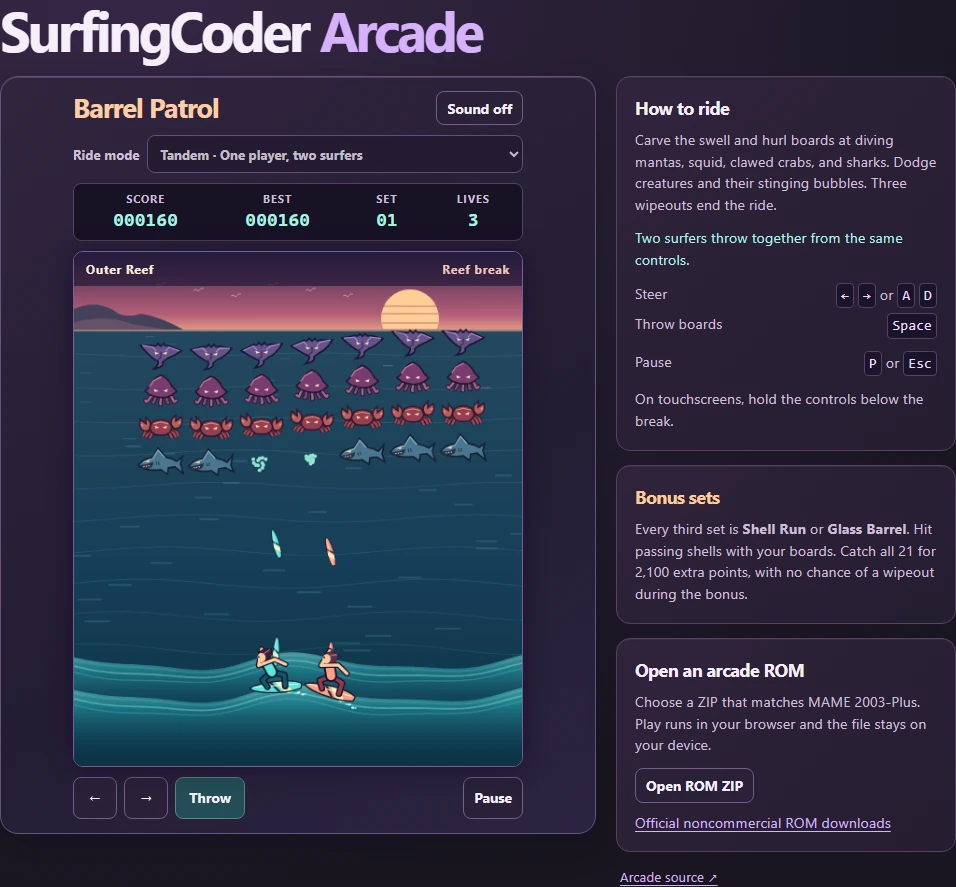

# SurfingCoder Arcade

[Play Barrel Patrol](https://surfingcoder.com/arcade/), an original formation shooter set on a sunset reef break. Ride the moving crests and throw surfboards at mantas, squid, puffers, and reef fish. Dodge diving creatures and stinging bubbles. Three wipeouts end the ride.



## Ride modes

| Mode | Controls |
| --- | --- |
| **Solo** | Arrow keys or A / D to steer, Space to throw. |
| **Tandem** | Same controls. One player steers two surfers and throws both boards together. |
| **Local co-op** | Surfer 1 uses A / D and F or Space. Surfer 2 uses the arrows and slash or numpad zero. Score and lives are shared. |

Press P or Escape to pause. On touchscreens, hold the buttons below the playfield. Choose a ride mode before starting. Each mode keeps its own best score on this device.

## Bonus sets

Every third set is a bonus round. Shell Run sends shells in arcing groups. Glass Barrel sends them in S-shaped paths. Throw a board to catch each shell for 150 points. Catch all 21 for 2,100 more. Bonus sets have no creatures or bubbles that can cost a life.

## Open a ROM

Select **Open ROM ZIP** and choose a ZIP compatible with [MAME 2003-Plus](https://docs.libretro.com/library/mame2003_plus/). A self-contained arcade set with its original filename is recommended. The page passes the selected file directly to the browser player. The emulator loads from the pinned [EmulatorJS CDN](https://cdn.emulatorjs.org/4.2.3/data/), and the ROM stays on your device. See [EmulatorJS source and license](https://github.com/EmulatorJS/EmulatorJS/tree/v4.2.3) and the [MAME 2003-Plus core](https://github.com/libretro/mame2003-plus-libretro).

[MAMEDev's official downloads](https://www.mamedev.org/roms/) include Alien Arena and other titles distributed for noncommercial use. Barrel Patrol runs as JavaScript and is built into the page.

## Run locally

Serve this directory with Python and open [localhost:8000](http://127.0.0.1:8000/).

```sh
python -m http.server 8000 --bind 127.0.0.1
node --test
```
